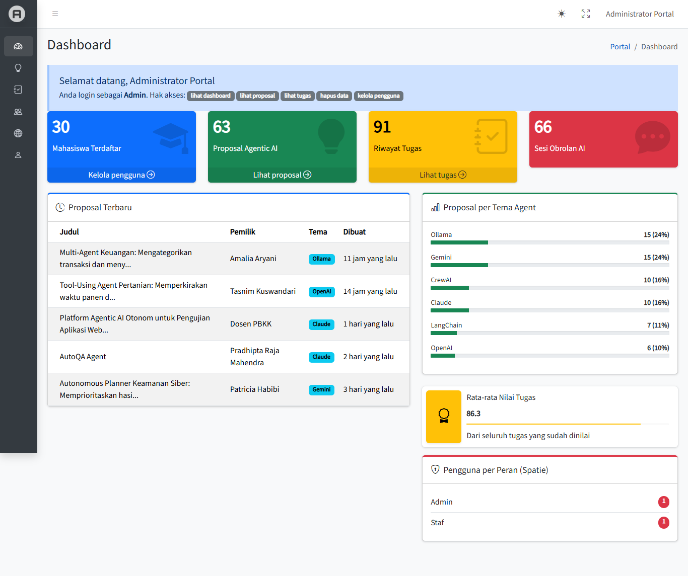
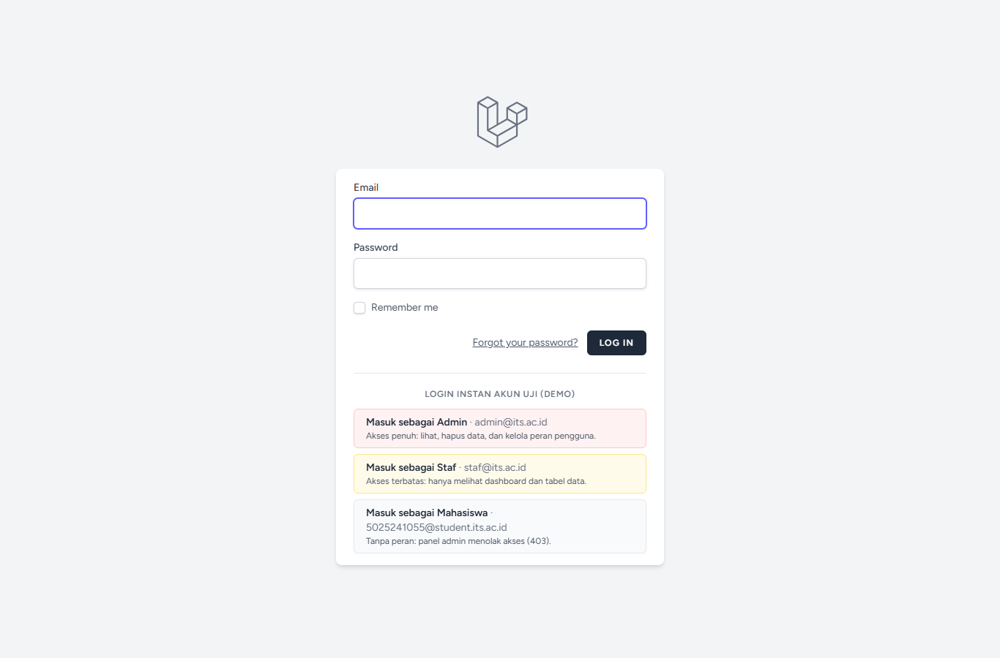
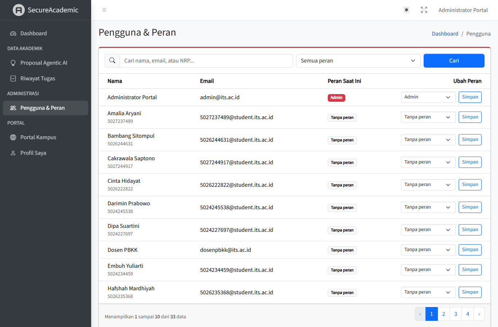
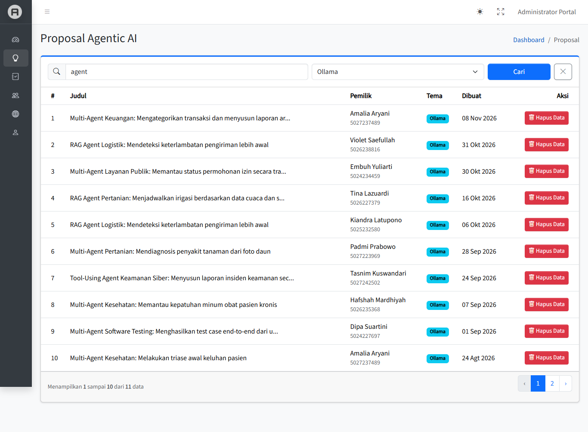
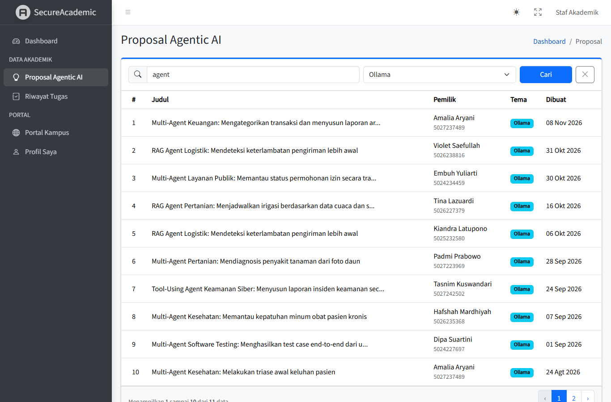
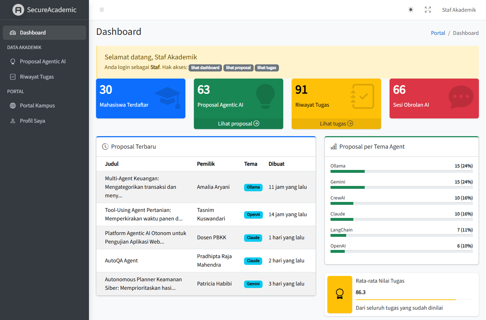
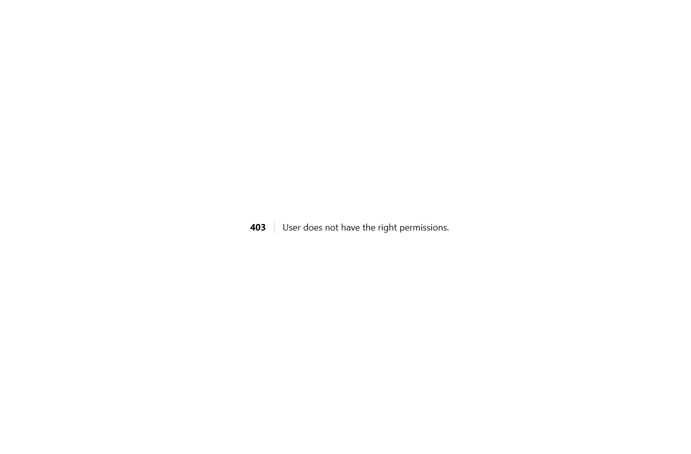

# Secure Academic Portal: Dashboard & RBAC

Tugas mandiri PBKK Pertemuan 10: lanjutan proyek **Secure Academic Portal** (Laravel 13 + Breeze), ditambah panel admin **AdminLTE** dan otorisasi dinamis **Spatie Laravel Permission** dengan dua peran, **Admin** (akses penuh) dan **Staf** (akses terbatas).

**Himawan Rakha Bhadra 5025241028** · Teknik Informatika · Institut Teknologi Sepuluh Nopember (ITS)



## Akun Uji (Auto-Login)

Halaman `/login` menyediakan tombol **login instan** untuk ketiga akun berikut, jadi demo tidak perlu mengetik email dan password. Semua akun memakai password `password`.

| Tombol                  | Email                          | Peran         | Hak akses                                                                           |
| ----------------------- | ------------------------------ | ------------- | ----------------------------------------------------------------------------------- |
| Masuk sebagai Admin     | `admin@its.ac.id`              | Admin         | `lihat dashboard`, `lihat proposal`, `lihat tugas`, `hapus data`, `kelola pengguna` |
| Masuk sebagai Staf      | `staf@its.ac.id`               | Staf          | `lihat dashboard`, `lihat proposal`, `lihat tugas`                                  |
| Masuk sebagai Mahasiswa | `5025241055@student.its.ac.id` | (tanpa peran) | Tidak bisa membuka panel admin (403)                                                |
| (login manual)          | `dosenpbkk@its.ac.id`          | (tanpa peran) | Akun dosen demo dari pertemuan sebelumnya                                           |
| (login manual)          | `NRP@student.its.ac.id`        | (tanpa peran) | 29 mahasiswa acak hasil Faker, lihat tabel `users`                                  |



Tombol auto-login hanya muncul dan hanya bisa dipakai bila `DEMO_LOGIN_ENABLED=true` **dan** `APP_ENV` bukan `production`. Server hanya menerima kunci akun `admin`, `staf`, dan `mahasiswa` yang terdaftar di `config/demo.php` (bukan email bebas), dan rutenya dibatasi `throttle:10,1`.

## Instalasi

Prasyarat: PHP 8.3+, Composer, Node.js 20+, dan SQLite atau MySQL/MariaDB.

```bash
git clone https://github.com/HimawanRakha/IndividualAssesmentPBKK secure-academic-portal
cd secure-academic-portal
composer install
npm install
cp .env.example .env
php artisan key:generate
```

Atur database di `.env`:

- **MySQL**: buat database `secure_academic_portal` (utf8mb4), lalu sesuaikan `DB_USERNAME` dan `DB_PASSWORD`.
- **SQLite** (paling cepat): ubah `DB_CONNECTION=sqlite`, beri tanda `#` pada baris `DB_HOST` sampai `DB_PASSWORD`, lalu buat berkas kosong `database/database.sqlite`.

Jalankan migrasi sekaligus seeder otomatis, build aset, lalu jalankan server:

```bash
php artisan migrate:fresh --seed
npm run build
php artisan serve
```

Buka http://127.0.0.1:8000/login, lalu klik salah satu tombol auto-login. Admin dan Staf langsung diarahkan ke panel admin `/admin`; mahasiswa diarahkan ke `/dashboard`.

Alternatif satu perintah (setelah `.env` dan database siap): `composer run setup` menjalankan instalasi, `migrate --seed`, dan build aset.

## Fitur Pertemuan 10

### 1. Integrasi UI Backoffice: AdminLTE

- Paket `jeroennoten/laravel-adminlte` v4 (AdminLTE 4 + Bootstrap 5.3 + Bootstrap Icons, tanpa jQuery). Aset di-publish ke `public/vendor/adminlte` lewat `php artisan adminlte:install`.
- Semua halaman panel admin mewarisi `@extends('adminlte::page')` dan memakai komponen AdminLTE (`x-adminlte-small-box`, `x-adminlte-card`, `x-adminlte-info-box`, `x-adminlte-callout`, `x-adminlte-alert`).
- Menu sidebar diatur di `config/adminlte.php`. Setiap item punya kunci `can` berisi nama permission Spatie, sehingga menu yang tidak berhak diakses otomatis tersembunyi (Staf tidak melihat bagian **ADMINISTRASI**).
- Mode gelap/terang dan fullscreen tersedia dari navbar.

| Halaman             | URL               | Admin            | Staf          |
| ------------------- | ----------------- | ---------------- | ------------- |
| Dashboard           | `/admin`          | ✅               | ✅            |
| Proposal Agentic AI | `/admin/proposal` | ✅ lihat + hapus | ✅ lihat saja |
| Riwayat Tugas       | `/admin/tugas`    | ✅ lihat + hapus | ✅ lihat saja |
| Pengguna & Peran    | `/admin/pengguna` | ✅ ubah peran    | ❌ 403        |

### 2. Sistem Autentikasi: Laravel Breeze

Seluruh rute `/admin/*` berada di bawah middleware `auth` + `verified` milik Breeze, ditambah `role:Admin|Staf`. Tamu diarahkan ke `/login`, user tanpa peran mendapat 403.

```php
// routes/web.php
Route::middleware(['auth', 'verified', 'role:Admin|Staf'])
    ->prefix('admin')
    ->name('admin.')
    ->group(function () { /* ... */ });
```

### 3. Otorisasi Dinamis di Database: Spatie Permission

- Migrasi Spatie membuat tabel `roles`, `permissions`, `model_has_roles`, `model_has_permissions`, dan `role_has_permissions`. Peran dan hak akses **tidak ditulis di kode**, melainkan dibaca dari tabel tersebut.
- `RolePermissionSeeder` membuat 5 permission dan 2 peran, lalu menghubungkannya dengan `syncPermissions()`.
- Model `User` memakai trait `HasRoles`. Alias middleware `role`, `permission`, dan `role_or_permission` didaftarkan di `bootstrap/app.php`.
- Halaman **Pengguna & Peran** (khusus Admin) mengubah peran user secara langsung ke tabel `model_has_roles`. Admin tidak bisa mencabut peran Admin miliknya sendiri agar panel tidak terkunci.



### 4. Widget Dashboard Agregat

Beranda `/admin` menampilkan 4 small-box dari kueri `count()` di `Admin\DashboardController`: **Mahasiswa Terdaftar**, **Proposal Agentic AI**, **Riwayat Tugas**, dan **Sesi Obrolan AI**. Selain itu ada sebaran proposal per tema agent (`groupBy` + `count(*)`), rata-rata nilai tugas (`avg`), 5 proposal terbaru, dan khusus Admin, jumlah pengguna per peran (`Role::withCount('users')`).

### 5. Pengaman Controller dan Hak Eksklusif "Hapus Data"

Setiap controller admin mengimplementasikan `HasMiddleware` (pengganti constructor middleware di Laravel 11+) dengan middleware `permission:`, sehingga URL tetap terkunci walau diketik langsung:

```php
// app/Http/Controllers/Admin/ProjectController.php
public static function middleware(): array
{
    return [
        new Middleware('permission:lihat proposal', only: ['index']),
        new Middleware('permission:hapus data', only: ['destroy']),
    ];
}
```

Tombol **Hapus Data** dilindungi tiga lapis:

1. **Blade**: kolom Aksi dan tombolnya dibungkus `@role('Admin') ... @endrole`, jadi tidak dirender sama sekali untuk Staf.
2. **Middleware**: `permission:hapus data` pada method `destroy`.
3. **Pengecekan manual server-side**: `abort_unless($request->user()->hasRole('Admin'), 403)` di dalam `destroy`, sehingga hanya peran Admin murni yang bisa menghapus.

| Admin                                                     | Staf                                                    |
| --------------------------------------------------------- | ------------------------------------------------------- |
|  |  |

## Challenge (Nilai Plus)

### Filter Pencarian dengan `when()`

Tabel Proposal, Tugas, dan Pengguna punya form pencarian kata kunci dan filter dropdown. Kondisi hanya ditambahkan ke kueri bila parameternya diisi, sehingga controller tetap bersih tanpa deretan `if`:

```php
$projects = Project::query()
    ->with('user:id,name,nrp')
    ->when($filter['q'] ?? null, fn (Builder $query, string $q) => $query->cari($q))
    ->when($filter['tema'] ?? null, fn (Builder $query, string $tema) => $query->where('tema_agent', $tema))
    ->latest()
    ->paginate(10)
    ->withQueryString();
```

Logika pencarian (judul, tema/mata kuliah, nama, atau NRP pemilik) dipisah ke local scope `scopeCari()` di model `Project` dan `Assignment`. Input divalidasi dulu (`nullable|string|max:100`).

### Pengunci Link Pagination: `withQueryString()`

`->withQueryString()` membuat link halaman berikutnya tetap membawa filter, misalnya `/admin/proposal?q=agent&tema=Ollama&page=2`. Setelah menghapus data, `back()` juga mengembalikan Admin ke URL yang sama lengkap dengan filternya.

### Auto-Seeder Faker Realistis

`php artisan migrate:fresh --seed` (juga dipanggil oleh `composer run setup`) langsung mengisi database:

| Seeder                 | Isi                                                                                                 |
| ---------------------- | --------------------------------------------------------------------------------------------------- |
| `RolePermissionSeeder` | 5 permission, peran Admin dan Staf                                                                  |
| `AdminPanelUserSeeder` | Akun `admin@its.ac.id` (Admin) dan `staf@its.ac.id` (Staf)                                          |
| `PortfolioOwnerSeeder` | Akun pemilik portofolio beserta profil, proposal, dan tugasnya                                      |
| `StudentSeeder`        | 29 mahasiswa acak dari Faker `id_ID` (NRP, prodi, bio, minat), masing-masing 2 proposal dan 3 tugas |
| `DemoUserSeeder`       | Akun dosen demo dengan 3 proposal                                                                   |
| `ChatSeeder`           | 2 sesi obrolan Agentic AI per user beserta pesan dan log tool                                       |

Hasilnya **33 user, 63 proposal, 92 riwayat tugas, dan 66 sesi obrolan**. Semua seeder memakai `firstOrCreate`/`updateOrCreate` sehingga aman dijalankan berulang.

### Auto-Login Test Accounts

Lihat bagian [Akun Uji](#akun-uji-auto-login). Implementasinya ada di `Auth\DemoLoginController` dan `config/demo.php`.

## Skenario Demo di Kelas

1. Buka `/login`, klik **Masuk sebagai Admin**. Tunjukkan 4 widget, menu lengkap, dan kartu "Pengguna per Peran".
2. Buka **Proposal Agentic AI**, cari `agent` + tema `Ollama`, pindah ke halaman 2. Filter tetap terbawa di URL.
3. Klik **Hapus Data** pada salah satu baris. Muncul pesan sukses dan filter tetap terjaga.
4. Buka **Pengguna & Peran**, ubah peran seorang mahasiswa menjadi Staf.
5. Logout, klik **Masuk sebagai Staf**. Menu ADMINISTRASI hilang dan tombol Hapus Data tidak dirender.
6. Ketik manual `/admin/pengguna`, hasilnya 403. (Opsional: kirim `DELETE` lewat DevTools, hasilnya juga 403.)
7. Logout, klik **Masuk sebagai Mahasiswa**, lalu buka `/admin`, hasilnya 403.

| Staf: dashboard                            | Staf: akses `/admin/pengguna`                 |
| ------------------------------------------ | --------------------------------------------- |
|  |  |

## Pengujian dan Standar Kode

```bash
php artisan test          # 55 test, termasuk tests/Feature/AdminPanelTest.php (RBAC, pencarian, pagination, auto-login)
./vendor/bin/pint --test  # PSR-12 (preset Laravel Pint)
```

`AdminPanelTest` memverifikasi: tamu diarahkan ke login, user tanpa peran mendapat 403, widget tampil, tombol Hapus Data hanya dirender untuk Admin, Staf mendapat 403 saat mengirim `DELETE` langsung, Admin bisa menghapus, pencarian menyaring baris dan link halaman 2 tetap membawa `q=`, Staf tidak bisa membuka halaman pengguna, Admin tidak bisa mencabut peran Admin miliknya sendiri, dan auto-login hanya aktif bila diizinkan config.

## Keamanan Git

`.env`, `vendor/`, `node_modules/`, dan `public/build` sudah tercantum di `.gitignore` bawaan Laravel, sehingga tidak ikut ter-commit. Salin `.env.example` menjadi `.env` setelah clone.

## Struktur File Baru

```
app/Http/Controllers/Admin/{Dashboard,Project,Assignment,UserRole}Controller.php
app/Http/Controllers/Auth/DemoLoginController.php
config/adminlte.php, config/permission.php, config/demo.php
database/migrations/*_create_permission_tables.php
database/seeders/{RolePermission,AdminPanelUser}Seeder.php
resources/views/admin/dashboard.blade.php
resources/views/admin/{proposal,tugas,pengguna}/index.blade.php
resources/views/admin/partials/{search-form,status}.blade.php
lang/id.json
tests/Feature/AdminPanelTest.php
```

## Fitur dari Pertemuan Sebelumnya

Fitur lama tetap berjalan: portal kampus umum (`/`), portofolio publik dari database (`/portofolio`, `/profil-mahasiswa`, `/ide-agent`), dashboard profil mahasiswa (`/dashboard`), dan riwayat obrolan Agentic AI dengan polymorphic tool logging tanpa N+1 (`/chat`). API key proposal tetap terenkripsi (cast `encrypted`) dan disembunyikan dari tabel admin.
